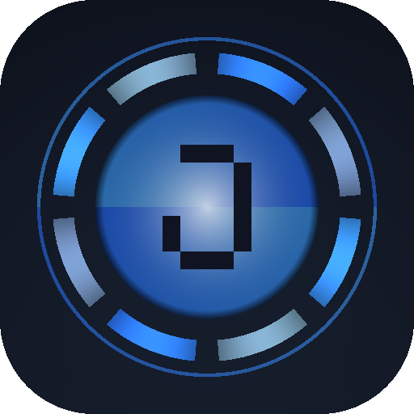

<div align="center">



# ⚡ JARVIS

### Your personal AI that *actually does things* — not just talks.

**Agentic desktop assistant + mobile companion.** Jarvis controls your PC, reads your files, searches the web, manages reminders, sees your screen, remembers everything — and answers you from Slack or your phone, anywhere.

[](https://github.com/Gauravsharma110044/Stonic-Jarvis)
[](https://build.nvidia.com)
[](LICENSE)

</div>

---

## ✨ What is Jarvis?

Jarvis is a **real, working AI assistant** — an Electron desktop app with a futuristic arc-reactor UI, a shared AI brain, and an ever-growing toolset. It doesn't just reply — it *executes*.

Ask it to open apps, run commands, analyze files, watch your screen, set reminders, control your mouse — and it does, with a visible plan and real results.

<div align="center">

```
┌─────────────────────────────────────────────────────────┐
│   🖥️  DESKTOP APP (Electron)                            │
│   Arc-reactor UI · Voice I/O · System metrics           │
│   Full PC control · 40+ tools · Vision · Memory         │
└───────────────┬───────────────────────┬─────────────────┘
                │                       │
        ┌───────▼────────┐      ┌───────▼────────┐
        │   Slack Bot    │      │  Mobile Bridge │
        │  (Socket Mode) │      │  (Tailscale)   │
        └───────┬────────┘      └───────┬────────┘
                │                       │
        📱 Slack on phone      📱 Native Android APK
                └───────┬───────┘
                        │
        ┌───────────────▼────────────────┐
        │   Shared AI Brain (NVIDIA)     │
        │   Nemotron 30B · Vision VL     │
        │   Memory · Scheduler · Vault   │
        └────────────────────────────────┘
```

</div>

---

## 🚀 Features

### 🧠 Agentic Core
- **40+ real tools** — files, shell, registry, processes, drives, apps, clipboard, notifications
- **Parallel tool execution** — multiple actions in one shot
- **Multi-step planning** — complex tasks get a plan, then execution
- **Task delegation** — sub-tasks run in fresh agent loops
- **Self-learning** — failures are remembered as lessons; Jarvis avoids repeating them

### 👁 Screen Intelligence
- **`see_screen`** — screenshot + vision AI analysis ("what's this error?")
- **`sys_watch`** — CPU/RAM/disk threshold alerts on an interval

### 🗂 Full System Access
- Read/write/search **any file** on any drive
- List installed apps, processes, drives, env vars, registry (read-only)
- Disk usage analysis, file metadata, content search

### 🖱️ Desktop Control
- Mouse move/click/scroll, keyboard typing — via Windows API
- `run_command`, `open_app`, `open_path`, `take_screenshot`

### 📅 Automation
- **Persistent scheduler** — one-time & recurring jobs (survives restarts)
- **AI-scheduled tasks** — "every morning at 9, send me a brief"
- **Background tasks** — long commands run async, results delivered when done
- **Encrypted vault** — AES-256-GCM secret storage

### 💬 Everywhere You Are
- **Desktop app** — full control surface
- **Slack bot** — DM & channel mentions, same brain
- **Mobile bridge** — private Tailscale network, native Android APK
- **Persistent memory** — facts & preferences remembered forever

### 🎨 The Interface
- Animated **arc-reactor core** — idle / listening / thinking / speaking states
- Real-time system metrics (CPU · RAM · SSD)
- Voice input (SpeechRecognition) + voice output
- Frameless window, custom Jarvis icon, dark futuristic theme
- Auto-updates via `electron-updater`

---

## 🛠 Tech Stack

| Layer | Tech |
|---|---|
| Desktop | Electron · React 18 · Vite |
| AI | NVIDIA NIM API (OpenAI-compatible) — free models |
| Agent | Custom tool-calling loop (6-step, parallel calls) |
| Remote | Slack Bolt (Socket Mode) · HTTP bridge |
| Mobile | Capacitor → native Android APK |
| Network | Tailscale (private mesh VPN) |
| Storage | JSON store · AES-256-GCM vault |
| Automation | PowerShell + Win32 API (mouse/keyboard) |

---

## ⚙️ Setup

### 1. Clone
```bash
git clone https://github.com/Gauravsharma110044/Stonic-Jarvis.git
cd Stonic-Jarvis
```

### 2. Install & configure
```bash
npm install
cp .env.example .env   # add your NVIDIA_API_KEY
```

### 3. Run
```bash
npm run dev     # dev mode
npm run dist    # build installer → release/
```

### 4. Mobile app (optional)
```bash
cd mobile-app
npm install
npx cap add android
# build APK via Android Studio / gradlew
```
Then connect via **Tailscale** on phone + PC.

### 5. Slack bot (optional)
See [`SLACK_SETUP.md`](SLACK_SETUP.md) — 5-minute setup with manifest.

---

## 🎯 Example commands

```
"open notepad and type hello world"
"what's on my screen right now?"
"search my Downloads for files containing 'password'"
"remind me in 20 minutes to check the oven"
"every morning at 9 send me news + weather summary"
"how much free space is on C drive?"
"save my wifi password to the vault"
"alert me if CPU goes above 80%"
"translate 'good morning' to Japanese"
```

---

## 🔒 Security notes

- `.env` is git-ignored — **never commit API keys**
- Vault uses machine-bound AES-256-GCM encryption
- Slack surface can invoke PC tools — keep your workspace private
- Tailscale provides encrypted private networking (no public exposure)

---

## 🌐 Website

Landing page + downloads: **[jarvis website](website/)** — deploy to Vercel with root directory `website`.

---

<div align="center">

**Built with ⚡ by Gaurav Sharma**

*Electron · React · NVIDIA AI · Coffee*

</div>
